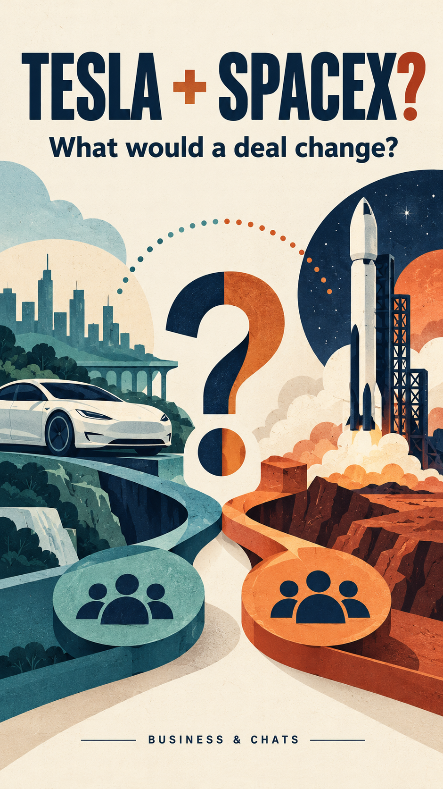
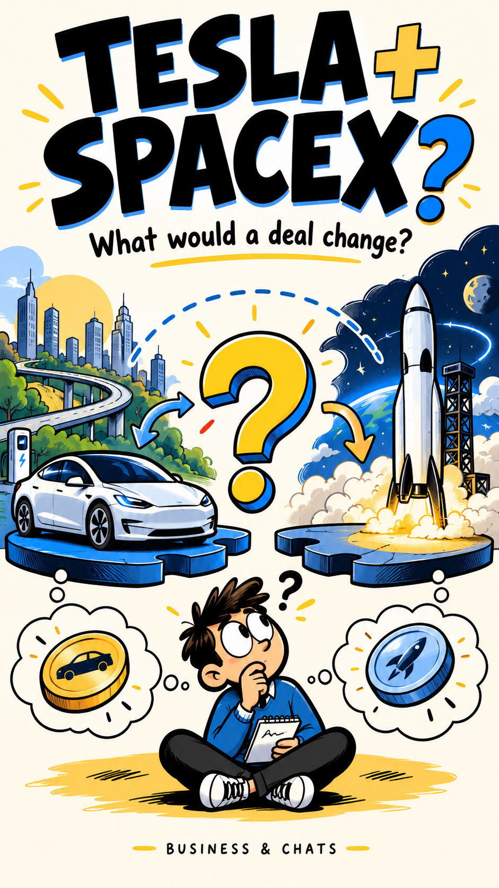
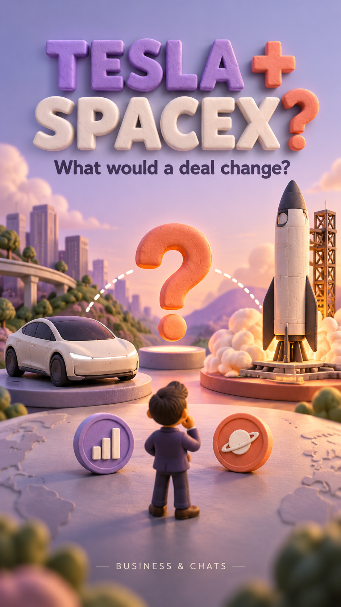
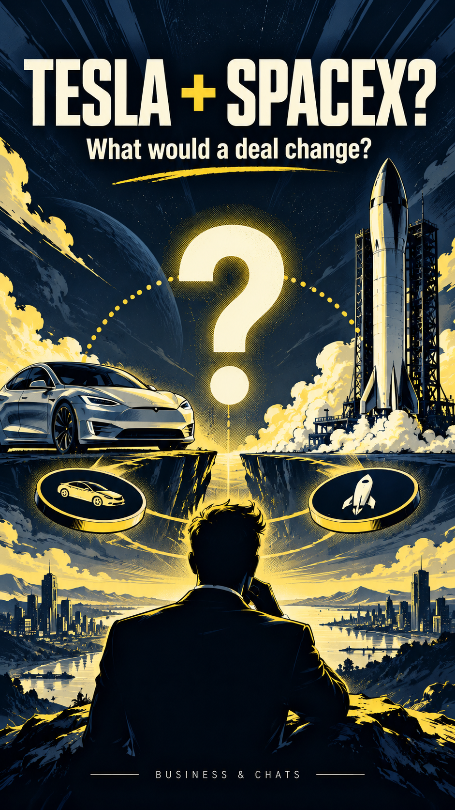

# Style draft prompts

Built-in image generation, 26 October 2026. Four separate preview images; no style has been selected. Historical prompt record: these images use superseded branding. The confirmed brand is Ourbites; use OURBITES in all future image prompts. Original prompts below are preserved to document the existing images.

## 01-editorial-cutout



```text
Use case: stylized-concept. Asset type: one vertical 9:16 style-frame concept for a YouTube business explainer. Create a single finished image, not a grid or comparison board. Topic: a POSSIBLE Tesla and SpaceX combination, treated as a question, not an announced completed merger. Shared concept for fair style comparison: a recognizable generic electric sedan on the left, a space rocket on the right, facing a large central question mark or dotted connecting arc, with small abstract ownership tokens beneath. Text exactly, large and crisp at top: "TESLA + SPACEX?" Small subhead exactly: "What would a deal change?" Small discreet footer: "BUSINESS & CHATS". No stock-price claims, no invented numerical data, no company logos. Editorial paper-cut collage animation keyframe. Beautiful flat vector-like cut paper with subtle printed grain, bold simplified silhouettes, warm ivory background, dark navy, muted teal and burnt orange. Asymmetric art-directed composition, sophisticated magazine economics illustration, precise separated elements easy to animate with 2.5D parallax. Not a dashboard or slide. Composition: visually engaging central illustration, strong mobile legibility, generous top and bottom safe space, professional editorial hierarchy, each object reads clearly at phone size. This is an animation style exploration, not a thumbnail with a shocked celebrity. No realistic depictions of actual events.
```

## 02-playful-2d



```text
Use case: stylized-concept. Asset type: one vertical 9:16 style-frame concept for a YouTube business explainer. Create a single finished image, not a grid or comparison board. Topic: a POSSIBLE Tesla and SpaceX combination, treated as a question, not an announced completed merger. Shared concept for fair style comparison: a recognizable generic electric sedan on the left, a space rocket on the right, facing a large central question mark or dotted connecting arc, with small abstract ownership tokens beneath. Text exactly, large and crisp at top: "TESLA + SPACEX?" Small subhead exactly: "What would a deal change?" Small discreet footer: "BUSINESS & CHATS". No stock-price claims, no invented numerical data, no company logos. Witty hand-drawn 2D cartoon animation keyframe for adult business education. Bold black outlines, intentionally simple expressive shapes, a quirky anonymous small investor character with a question mark expression, electric blue and warm yellow accents on cream. Intelligent visual humor, doodled arrows and rubber-hose influenced expressive poses, polished contemporary explainer cartoon. Not a children's cartoon, not a whiteboard slide. Composition: visually engaging central illustration, strong mobile legibility, generous top and bottom safe space, professional editorial hierarchy, each object reads clearly at phone size. This is an animation style exploration, not a thumbnail with a shocked celebrity. No realistic depictions of actual events.
```

## 03-clay-diorama



```text
Use case: stylized-concept. Asset type: one vertical 9:16 style-frame concept for a YouTube business explainer. Create a single finished image, not a grid or comparison board. Topic: a POSSIBLE Tesla and SpaceX combination, treated as a question, not an announced completed merger. Shared concept for fair style comparison: a recognizable generic electric sedan on the left, a space rocket on the right, facing a large central question mark or dotted connecting arc, with small abstract ownership tokens beneath. Text exactly, large and crisp at top: "TESLA + SPACEX?" Small subhead exactly: "What would a deal change?" Small discreet footer: "BUSINESS & CHATS". No stock-price claims, no invented numerical data, no company logos. Premium stylized 3D clay miniature animation keyframe. Tactile softly imperfect clay car and rocket, handcrafted small business-world diorama, rounded geometry, soft studio shadows, lilac and coral with cream. Sophisticated stop-motion feeling, playful but financially credible. A tiny anonymous investor figurine visually compares the two companies. No photoreal humans. Composition: visually engaging central illustration, strong mobile legibility, generous top and bottom safe space, professional editorial hierarchy, each object reads clearly at phone size. This is an animation style exploration, not a thumbnail with a shocked celebrity. No realistic depictions of actual events.
```

## 04-financial-comic



```text
Use case: stylized-concept. Asset type: one vertical 9:16 style-frame concept for a YouTube business explainer. Create a single finished image, not a grid or comparison board. Topic: a POSSIBLE Tesla and SpaceX combination, treated as a question, not an announced completed merger. Shared concept for fair style comparison: a recognizable generic electric sedan on the left, a space rocket on the right, facing a large central question mark or dotted connecting arc, with small abstract ownership tokens beneath. Text exactly, large and crisp at top: "TESLA + SPACEX?" Small subhead exactly: "What would a deal change?" Small discreet footer: "BUSINESS & CHATS". No stock-price claims, no invented numerical data, no company logos. Cinematic graphic-novel animation keyframe, sharp ink outlines, limited dark navy, off-white and acid-yellow palette, dramatic perspective, halftone textures, bold angular shapes, dynamic graphic shadows. Adult financial editorial comic, readable and restrained, with an anonymous investor silhouette in foreground. High energy without visual clutter or photorealism. Composition: visually engaging central illustration, strong mobile legibility, generous top and bottom safe space, professional editorial hierarchy, each object reads clearly at phone size. This is an animation style exploration, not a thumbnail with a shocked celebrity. No realistic depictions of actual events.
```


